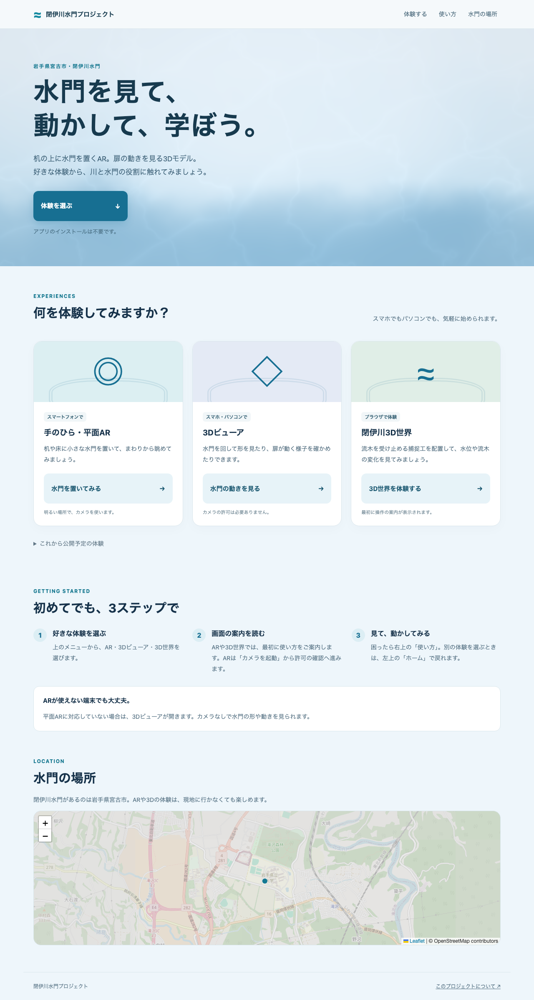
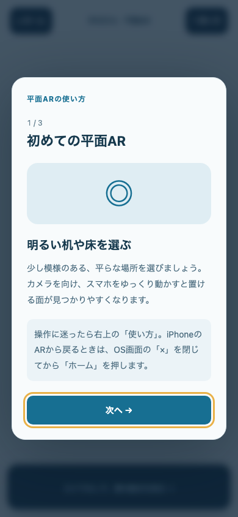
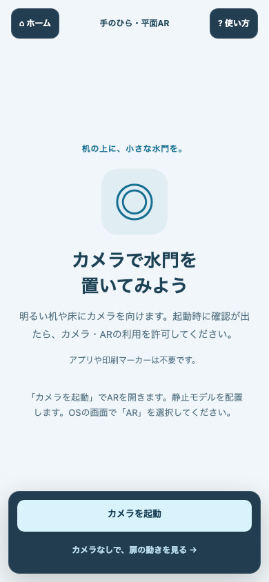
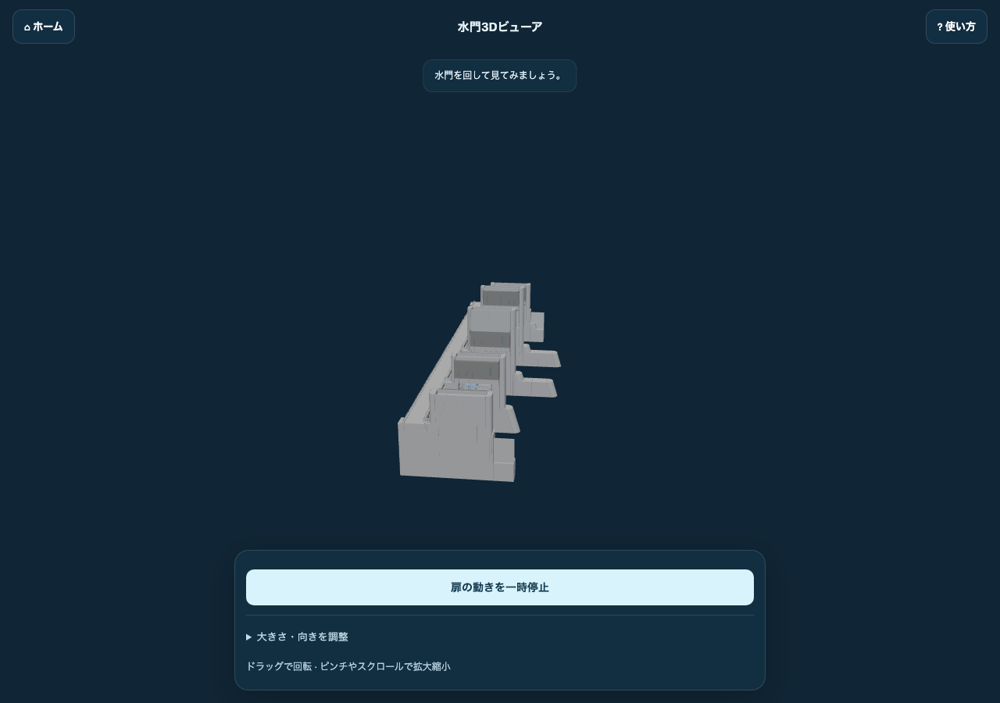
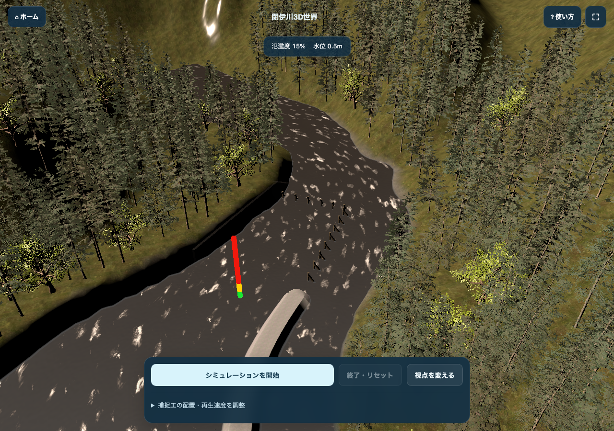

# 水門AR・閉伊川3D体験

机に小さな水門を置いたり、扉の動きを見たり、川のシミュレーションを試したりできるアプリです。

[体験ページを開く](https://haruto-sa.github.io/ARv2/) → 使いたい体験のボタンを押してください。

## 体験を選ぶ

- **手のひら・平面AR**：対応スマホで、机や床に水門を置きます。
- **3Dビューア**：カメラなしで、水門の形や扉の動きを見ます。PCでも使えます。
- **閉伊川3D世界**：捕捉工を置いて、流木や水位の変化を観察します。

現地AR・点群3D空間・360度動画は準備中です。地図では水門の場所を確認できます。

## スマホで水門を置く

1. 初回に表示される使い方を読み、明るい机や床を選びます。
2. 「カメラを起動」を押し、端末が求める許可を確認します。
3. 端末をゆっくり動かして平面を探します。WebXR対応端末では円が出たら「ここに配置」。iPhoneでは開いたシステム画面でARタブを選びます。

iPhoneでは静止した水門を表示します。扉の動きは3Dビューアで確認してください。PCやAR非対応のスマホでは、自動的に3Dビューアへ進みます。

左上の「ホーム」で体験メニューへ戻れます。iPhoneのシステムAR画面では、先に閉じるボタンでブラウザへ戻ってください。右上の「使い方」で案内を読み直せます。

*上の画像はスマホサイズのブラウザで撮影した案内・起動画面です。実機のカメラ映像ではありません。*

## 水門の形と動きを見る

水門をドラッグすると回転します。2本指のピンチ、またはPCのホイールで拡大できます。画面下のボタンで扉の動きを再生・一時停止し、「大きさ・向きを調整」で水門の幅や向きを変更できます。

カメラの許可は必要ありません。右上の「使い方」で操作を確認できます。

## 川の変化を試す

1. 初回の3つの案内を読んで「体験を始める」を押します。3Dデータの読み込みが終わるまで待ちます。
2. 画面下の「捕捉工の配置・再生速度を調整」を開き、「初期位置に置く」を押します。位置を変えたいときは「捕捉工をドラッグ」を押したまま画面上へ動かします。
3. 「シミュレーションを開始」で観察します。「視点を変える」で角度を切り替え、「終了・リセット」でやり直せます。

捕捉工は流木を受け止める設備です。上部の水位・氾濫度を見ながら、配置を変えて試してみてください。再生速度も変更できます。

## 困ったとき

- **カメラが起動しない**：ブラウザのカメラ・ARの許可を確認して再試行してください。対応端末の標準ブラウザで開き、カメラが使えない場合は3Dビューアを選んでください。
- **平面が見つからない**：明るく模様のある机や床で、端末をゆっくり動かしてください。
- **3D世界の読み込みが進まない**：通信を確認してください。読み込みに失敗した場合は画面の再試行ボタンを押してください。
- **使い方を忘れた**：各体験の右上の「使い方」を押してください。

## モデルの配置を確認したい方へ

[デモ・本番それぞれの配置検証手順](docs/placement-verification.md)をまとめています。スマホで明るい机に置き、定規で初期サイズを確認し、周りから見て接地と位置の固定を確かめます。

URLに `?verify=1` を付けると「配置の検証記録」から、接地の目安と状態のJSONを確認できます。iPhoneのシステムAR画面の配置状態は取得できないため、定規・目印と写真で確認してください。

## しくみも知りたい方へ

[画面ごとのやさしい技術解説](https://haruto-sa.github.io/ARv2/docs/ar-engineering-guide.html)では、各ページの操作と裏側のしくみを説明しています。リポジトリ内の[HTML版](public/docs/ar-engineering-guide.html)も利用できます。

開発環境や設定については[開発者向けドキュメント](docs/development.md)をご覧ください。
