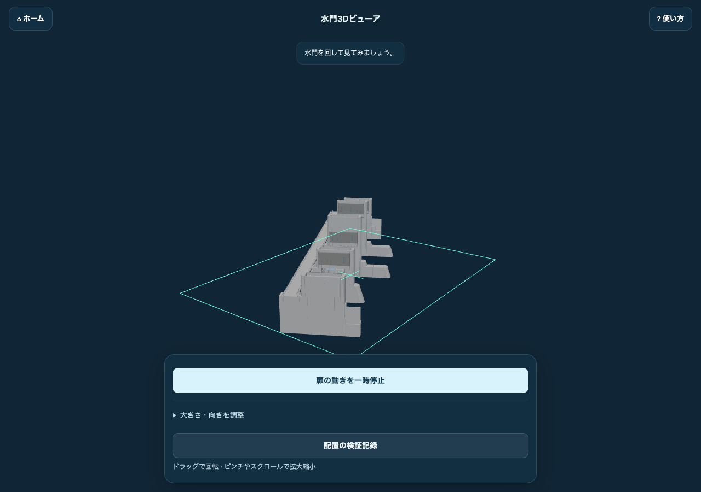
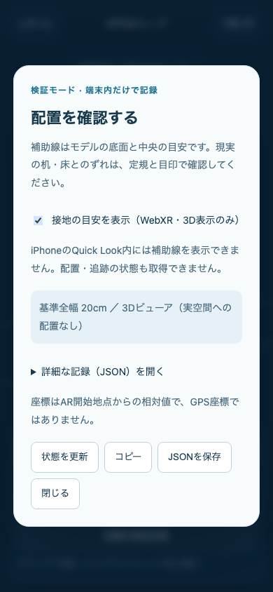

# モデルの配置を確認する方法（デモ・本番）

まず「表示できること」と「現実の正しい場所に置けること」を分けて確認します。3Dビューアは形・向き・動きの確認、スマホのARは接地・実寸・固定の確認に使います。PCの画面で表示できても、実空間での配置が合格したことにはなりません。

## 現在の公開状況

2026-10-13に確認したGitHub Pages本番の `/ARv2/ar/place/` と `/ARv2/viewer/` は **404** でした。平面ARと新UIは `feat/lab-restructure` にマージ済みですが、公開元の `main` には未反映です。本番検証を始めるには、今回の修正を含むリリースを `main` に取り込み、デプロイが完了している必要があります。Cloudflareの本番URL・公開対象ブランチはダッシュボードで確認してください。過去の一時トンネルURLを本番URLとして使わないでください。

公開URLに対する自動チェックでも、ビルド情報・AR・ビューア・平面サイズ設定の404と、地点設定の `debug:true` を検出しました。これらは今回の修正とリリースの反映後に再確認します。

本番が404のままなら、「ARの精度が悪い」のではなく「検証する版が未配信」です。以下の確認コマンドは、その違いも検出します。

## デモと本番の違い

| | デモ・開発者プレビュー | 本番 |
| --- | --- | --- |
| 目的 | 配置と端末対応、GPS方式の比較、補正値を探す | 利用者が同じ配置を再現できるか確認 |
| 成果物 | `INCLUDE_LAB=1` でビルド | `INCLUDE_LAB` を指定せずビルド |
| 平面AR | `/ar/place/?verify=1` | GitHub Pagesは `/ARv2/ar/place/?verify=1`、Cloudflareは `/ar/place/?verify=1` |
| カメラなし | `/viewer/?verify=1` | GitHub Pagesは `/ARv2/viewer/?verify=1` |
| GPS比較 | `/lab/compare/`、`/lab/ar/...` が使える | `/lab/` は公開しない。現地ARは現在未公開 |
| 検証用建物 | 第二地域連携棟の仮モデルがある | モデルと地点設定を出力しない |
| 補正設定 | 地点設定の `debug:true` を利用できる | 出力される地点設定は `debug:false` |
| 同じ版か | `build-info.json` の `commit` を記録 | 同じ `commit` で比較。`hasTrackedChanges:false` も確認 |

`?verify=1` は今回追加した明示的な検証モードです。通常の画面には検証ボタンが出ません。JSONは自分でコピー・保存したときだけ端末内へ出力し、サーバーへ送信しません。

## 1. デモを用意する

平面ARのあるブランチで作業します。設定値やモデルを変更したら再ビルドします。`dev` だけでなく、静的な成果物も確認するため、次の方法を使います。

```bash
npm ci
npm run check
npm test
npm run validate-config
INCLUDE_LAB=1 npm run build
npm run verify-placement -- --dir dist --expect demo
npm run preview -- --host 127.0.0.1 --port 4331
```

別ターミナルで、スマホ用HTTPSを用意します。

```bash
cloudflared tunnel --url http://127.0.0.1:4331 --http-host-header localhost
```

表示されたURLをスマホの標準ブラウザで開きます。スマホから `http://PCのIPアドレス:4331` を開くだけでは、カメラ・WebXRの検証条件を満たしません。実際のURLを記録してください。トンネルとPCを起動したままにします。

## 2. 平面ARの配置を実機で確認する

用意するものは、20cmを測れる定規、机に貼る目印、明るく模様のある平らな面、スマホです。同じ条件でデモと本番を試します。

1. `/ar/place/?verify=1` を開き、使い方を読みます。モデルの準備が終わるまで待ちます。
2. 「配置の検証記録」を開き、版・モデルのパス・初期全幅 `0.2m` を確認します。閉じてカメラを起動し、求められた許可を確認します。
3. 机に置く中心の目印を貼ります。WebXRでは円を目印に合わせて「ここに置く」を押します。iPhoneではQuick Lookの **ARタブ** に切り替え、OSの手順で配置します。
4. **底面**：正面だけでなく、机に近い低い角度から見ます。底面が浮いたり、机に埋まったりしていないか確認します。
5. **サイズ**：初期状態で拡縮せず、実際の定規と比べます。20cmは初期の向きで計算したモデルの水平外接枠の全幅です。扉1枚の幅や、画面上のピクセル幅ではありません。
6. **向き**：正面・側面・裏から見て、扉や支柱の形が左右反転していないか確認します。WebXRでは向きを変え、補助線も同じ角度で回ることを確認します。
7. **固定**：スマホを左右・前後に動かし、置いた目印にモデルが残るか見ます。カメラに張り付いて一緒に動く場合は不合格です。
8. **ドリフト**：60秒間、同じ観察位置でモデルと目印のずれを記録します。AR座標が同じでも、現実の目印からずれていれば不合格です。
9. **追跡の復帰**：一度机からカメラを外して戻します。WebXRでは追跡できない間はモデルを隠して案内し、復帰後に元の目印とのずれを再確認します。Quick Lookの挙動は動画・写真で記録します。
10. **やり直し**：WebXRの「置き直す」で別の目印に配置し、古い場所へ戻らないか確認します。終了→再開、右上の使い方、ホームへ戻る操作も試します。

最初の確認では、全幅 **20±2cm**、接地・60秒後の目印からのずれ **2cm以内**を暫定目安にします。これは今回の机上確認用の提案で、実機で達成済みという意味ではありません。端末・環境ごとに3回試し、実測値を保存してください。展示などでより高い精度が必要なら、開始前に基準を決め直します。

### WebXRの検証表示





画像はブラウザで表示して撮影したものです。実機のARカメラ映像ではありません。

「配置の検証記録」で「接地の目安を表示」を選ぶと、底面の外接枠と中心の十字が出ます。モデルと同じ位置・回転・サイズで動く補助線であり、机の高さを独立に測定した線ではありません。実際の机・目印・定規との比較が必要です。

- `placedPositionMeters`：AR開始時のlocal参照空間内の位置。GPSの緯度経度ではありません。
- `modelReferenceDimensionsMeters`：初期モデル形状から計算した基準寸法。追加回転後の画面上の横幅や、動く扉の瞬間的な外接枠ではありません。
- `baselineYawDegrees` / `additionalYawDegrees`：モデルの設定上の向きとスライダーの追加回転。真北への方位の保証ではありません。
- `tracking: tracking/lost`：追跡の状態。
- `anchoring: anchor/local/pending`：Anchorで補正中、local座標で固定、Anchor作成待ち。`local`でも配置できます。精度は実機で判定します。
- `events`：配置・追跡喪失・復帰・終了などの状態変化。最大50件です。

確認時に「状態を更新」→「JSONを保存」。時刻・版・追跡状態を、そのときの写真や動画と一緒に残します。

### iPhone / Quick Lookの違い

この経路ではOSが平面検出・配置・回転・拡縮を担当します。Webから配置座標・Anchor・追跡状態を取得できないため、レポートに `native-unobservable` と表示します。これは「追跡失敗」ではなく「ブラウザから観測できない」という意味です。

- 初期全幅は生成したUSDZの設定値。OS内でピンチした後の実寸はレポートに反映されません。初期サイズを確認するときは閉じて開き直し、拡縮前に測ります。
- Webの接地補助線はQuick Lookには入りません。目印・定規と実機の写真や画面録画で検証します。
- このUSDZは静止モデルです。扉の動きは3Dビューアで確認します。
- OSの閉じるボタンでブラウザへ戻り、ホームへ移動します。

## 3. 3Dビューアで確認できること

`/viewer/?verify=1` で、全幅20cmの設定、底面中央の原点、形、反転の有無、扉の動き、幅・向き変更、検証JSONの保存を確認できます。PC・非対応スマホはARページから自動でここへ進み、検証モードも引き継ぎます。

ビューアのピンチやホイールは **カメラの距離** を変える操作です。ARの実寸計測には使えません。画面に定規を当てても、モデルの実寸は確認できません。

## 4. 本番を検証する

### 配信前

同じコミットから本番用にビルドします。

```bash
# GitHub Pages（/ARv2/ 配信）
DEPLOY_TARGET=gh-pages npm run build
npm run verify-placement -- --dir dist --expect production

# Cloudflare（/ 配信）
DEPLOY_TARGET=cloudflare npm run build
npm run verify-placement -- --dir dist --expect production
```

CIでも両方を検証します。AR・ビューアのHTML、設定、GLBファイルのヘッダー、本番の `debug:false`、検証用ページ・設定・モデルの除外を確認します。`validate-config` も、設定が参照するモデルの欠落を検出します。

### 配信後

GitHub Pagesの本番は `main` への取り込み後にデプロイされます。デプロイ完了後、**公開URLそのもの**を確認します。

```bash
npm run verify-placement -- --url https://haruto-sa.github.io/ARv2/ --expect production
```

Cloudflareは実際の本番URLを `--url` に渡します。デモの公開URLの場合は `--expect demo` です。同じ版であることまで確認するときは、保存したコミットIDを指定します。

```bash
npm run verify-placement -- --url https://haruto-sa.github.io/ARv2/ --expect production --commit <リリースのコミットID>
```

コマンドが通ったら、スマホで `/ARv2/ar/place/?verify=1` を開き、上記の実機手順をもう一度行います。デモで動いたことだけを本番の合格にしないでください。権限を拒否→再試行、AR非対応端末→ビューア、初回案内・使い方の再表示、ホーム、キャッシュを空にした初回読み込みも確認します。

## 5. 現地の実物大モデルを確認する場合

これは机上の平面ARとは別の検証です。現在はデモの `/lab/` に比較用の位置情報ARがあり、公開版 `/ar/onsite` は未実装です。

- デモで `/lab/ar/locar?loc=lab-chiiki2`、`/lab/ar/arjs?loc=lab-chiiki2`、`/lab/ar/deviceorientation?loc=lab-chiiki2&debug=1` を同じ場所で比較します。
- 第二地域連携棟のモデルは既存の仮モデルを復元したものです。高さ6mは仮定なので、実高さの合否判定に使いません。建物の外形・配置位置の比較に限定します。
- GPSの精度、カメラ位置、方位、モデルの原点、設定の緯度経度・高さ・向き・補正量を記録します。URLで座標を上書きした場合と、補正UIの一時値も別に記録します。
- [仕様書 §4.2](ar-spec.md#42-張り付きの評価指標)に従い、30m地点での角のずれ、60秒のドリフト、20m歩いて戻ったずれ、カメラ追従、起動時間、5回中の成功回数を測ります。
- 補正UIは値を探すためのものです。確定値を地点JSONへ転記し、再ビルドした成果物で再検証します。
- 本物の閉伊川水門の実測位置・実寸・方位、採用する追跡方式は現地で別途確定が必要です。机上ARの20cmやGPSだけの表示成功から、現地精度を推定しないでください。

## 記録と判定

[検証記録テンプレート](eval/placement-run-template.md)をコピーして、環境ごと・端末ごと・試行ごとに記入します。版が違う、モデルが欠落、ARが起動しない、机に固定されない、基準以上のずれがある場合は不合格または未検証にします。

自動テストではWebXRの実空間追跡、OSのQuick Look起動、実寸精度を実証できません。2026-10-11には利用者によるスマホ動作確認の報告がありますが、今回の変更後の実機計測結果は未記録です。

WebXRの操作UIの範囲とタップ抑制は[W3C DOM Overlays仕様](https://www.w3.org/TR/webxr-dom-overlays-1/)を参照しています。Quick Lookは[Apple公式説明](https://developer.apple.com/quick-look-gallery/)を参照してください。
